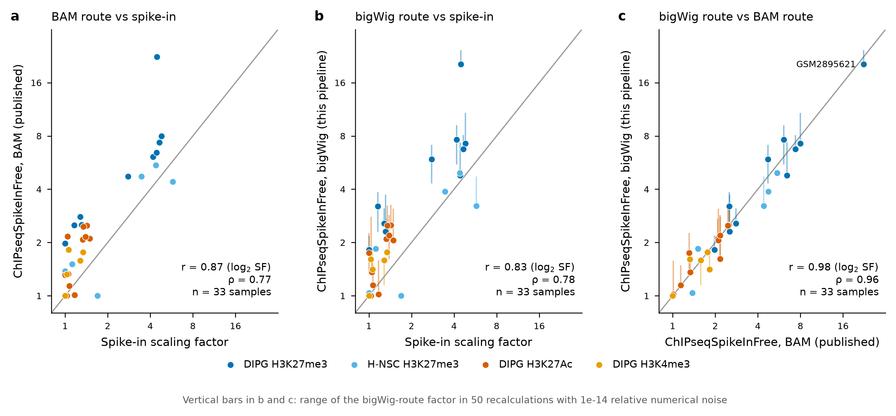
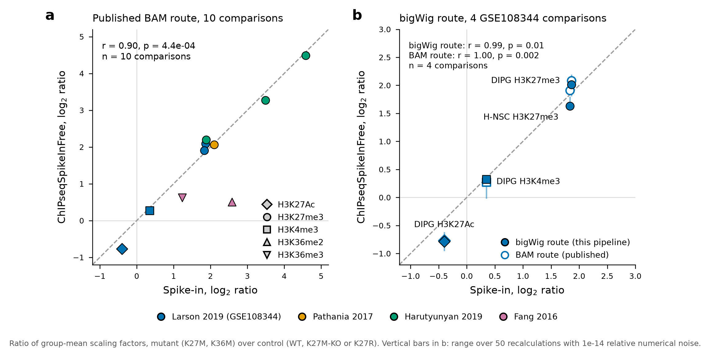

# Benchmark: ChIPseqSpikeInFree from bigWig tracks vs BAM files vs spike-in

Component 1 / Gate 1 of the ChIP-Atlas global-shift audit plan. Date: 2026-11-20.

## What was tested

* **Data:** Dataset 1 of btz720 Supplementary Table 1 = GSE108344 (Larson et al. 2019), 33 samples: mouse DIPG tumours
  (H3K27ac 11, H3K27me3 11, H3K4me3 5) and H-NSC (H3K27me3 6), K27M vs WT, mm9. This is half of the 66 samples of Table 1.
* **Input:** the per-sample bigWigs that GEO provides (`bigwig_url` column of the main table), read in place over HTTP range
  requests (no full download; 90-300 MB transferred per file, 20-75 s each, all 33 without failure).
* **Method:** `bin/csif_bigwig_bin.py` (1 kb bins identical to `GenerateBins()`, bigWig signal summed per bin, rescaled to 20e6
  pseudo reads) followed by the package's own `ParseReadCounts()`, `CalculateSF()`, `PlotDistr()`, `BoxplotSF()` with default
  settings, one run per cell system x mark (as in the paper; the minimum factor of 1 in each group indicates that).
* **References:** Table 1 columns "Scaling factor (SpikeIn)" and "Scaling factor (ChIPseqSpikeInFree)" (BAM route). The BAM
  route was **not re-run**: BAMs for this dataset were not available.
* **Criteria fixed before any bigWig factor was computed:** `gate1_prespecified_criteria.txt` (my choice; the plan gave no numbers).
* **The GEO bigWigs are already spike-in scaled** (per the GEO processing text). A per-sample constant cancels in
  `ParseReadCounts()`: scaling the counts by random per-sample factors changed the parsed matrix by at most 1.1e-15
  (`sensitivity_scaled_and_rounded_DIPG_H3K4me3.csv`), so the spike-in factors do not leak into the estimate.

*Each point is one sample (n = 33). Vertical bars in b and c: range of the bigWig-route factor in 50 recalculations with 1e-14
relative numerical noise (see below).*

## Results

Main table: `dataset1_scaling_factors_three_methods.csv` (one row per sample, three sets of factors, noise ranges, QC calls, log2 ratios).
`sf_bigwig_pipeline` is the factor as the Nextflow pipeline computes it (parsed matrix re-read from file); `sf_bigwig_single_run`
is the one-process run the criteria were evaluated on first.

| Comparison (n = 33) | Pearson r, log2 SF | Spearman | median abs log2 difference |
|---|---|---|---|
| bigWig route (pipeline path) vs published BAM route | 0.977 | 0.964 | 0.129 |
| bigWig route (pipeline path) vs spike-in | 0.834 | 0.775 | 0.639 |
| published BAM route vs spike-in | 0.868 | 0.773 | 0.543 |

The bigWig route agrees with spike-in about as well as the published BAM route does. Per group (`dataset1_per_group_summary.csv`),
mean factor of K27M over WT: DIPG H3K27me3 3.64 (spike-in) / 4.24 (BAM) / 4.03 (bigWig); H-NSC H3K27me3 3.57 / 3.76 / 3.10;
DIPG H3K27ac 0.76 / 0.59 / 0.58; DIPG H3K4me3 1.27 / 1.21 / 1.25.

### Gate 1 against the criteria fixed in advance

| | P1 r >= 0.90 | P2 median abs log2 <= 0.15 | P3 QC failures <= 3 |
|---|---|---|---|
| single in-memory run (analysis fixed in advance) | 0.977 pass | 0.101 pass | 0 pass |
| pipeline path (matrix re-read from file) | 0.977 pass | 0.129 pass | 0 pass |
| 50 noise replicates, 1e-14 | 0.954-0.986, 50/50 pass | 0.122-0.327, **29/50 pass** | 0 failures in all |
| 50 noise replicates, 1e-10 | 0.952-0.989, 50/50 pass | 0.035-0.322, **37/50 pass** | 0 failures in all |

**Verdict:** Gate 1 passes as pre-specified, on the first realization and on the pipeline path. P1 and P3 are robust. **P2 is not
robust**: it falls on either side of 0.15 depending on numerical noise alone, so the benchmark cannot resolve bigWig-vs-BAM
differences at the +/-0.15 (log2) level. It does exclude large bigWig-specific bias (r >= 0.95 in every replicate). On the pipeline path 21 of 33 samples are within +/-0.15 of the published BAM factor and the largest difference is 0.45 log2 (x1.37);
in the single run the largest is 0.61 (x1.5). The largest differences are spread over H3K27me3 and H3K27ac groups.

### Group-level log2 ratios (K27M over WT), as in the paper's comparison plot

`fig_group_log2_ratio_scatter.png`, `dataset1_group_log2_ratios_three_methods.csv`, `table1_all_comparisons_log2_ratios.csv`
(script `scripts/05_group_log2_ratio_scatter.py`). Each point is the log2 of the ratio of group-mean scaling factors, mutant over control.

| Group (GSE108344) | spike-in | BAM, published | bigWig (pipeline path) | bigWig range under 1e-14 noise |
|---|---|---|---|---|
| DIPG H3K27ac | -0.40 | -0.77 | -0.79 | -0.95 to -0.62 |
| DIPG H3K27me3 | 1.86 | 2.09 | 2.01 | 1.80 to 2.19 |
| DIPG H3K4me3 | 0.35 | 0.28 | 0.32 | -0.02 to 0.33 |
| H-NSC H3K27me3 | 1.84 | 1.91 | 1.63 | 1.63 to 1.80 |

* On these 4 comparisons the bigWig route correlates with spike-in at r = 0.99 (p = 0.01) and the published BAM route at r = 1.00
  (p = 0.002). **n = 4, so these r and p values carry little weight**; the span comes from two H3K27me3 groups near 2 and two groups near 0.
* The differences between routes (up to 0.28 log2, H-NSC H3K27me3) are comparable to the numerical-noise ranges of the bigWig route.
* **Panel a does not reproduce the paper's panel E exactly.** Rebuilt from Supplementary Table 1 with this definition, 8 of the 10 comparisons
  coincide with that panel, but the two H3K36 comparisons (T/C28a2, Fang 2016) have the same spike-in x and a lower ChIPseqSpikeInFree y
  (0.51 and 0.62 here, about 1.45 and 0.95 in the panel). Table 1 values give r = 0.90, p = 4.4e-4 (n = 10), not r = 0.96, p = 1.2e-5. I did not
  adjust anything to match; the panel may use a different averaging or updated factors for that dataset.
* Panel a (all datasets) is BAM-route only; the bigWig route was run on GSE108344 only.

## Finding: the scaling factor is numerically unstable (applies to BAM input too)

* Scaling the counts by random per-sample factors changed the parsed matrix by 1.1e-15, yet the factor of two of five samples
  changed. Recomputing the factors from the saved parsed matrices (what `CSIF_SCALE` does) changed **13 of 33** relative to the
  in-memory run.
* Relative noise of 1e-14 on the parsed matrix gives more than one distinct factor for **28 of 33** samples, up to **x1.78**
  between smallest and largest (`dataset1_bigwig_numeric_jitter_per_sample.csv`; all replicates in `dataset1_bigwig_csif_SF_jitter_long.csv`).
* **Cause (shown on GSM2895634):** `findLastTurnByPeak` is stable, but the automatic first turning point (`minFirstTurn = "auto"`)
  takes `which.max` of a second density computed on an evenly spaced grid. Its two highest values tie to 8 digits, and round-off
  decides between grid points 223 and 290, which moves the first turning point between CPMW 0.45 and 0.65 and the factor
  with it.
* **Exploratory mitigation:** with `minFirstTurn` fixed at 0.5 (the value the package's code comment calls empirically good), **0 of 33**
  samples changed under the same noise (spread 1.00; `..._SF_minFirstTurn0.5.csv`). Against the published BAM values it gives r = 0.979,
  median abs log2 0.143, and r = 0.880 vs spike-in. This changes the estimator relative to the published values and was tried on one
  dataset only; it is not a validated setting.
* Group-level fold changes are not immune: across the 50 replicates the K27M/WT fold varied x1.13-1.37 (largest over smallest) per
  group (`dataset1_bigwig_group_fold_change_under_noise.csv`).

Consequence for the plan: false-positive rates on replicates (Gate 2) and flagged-pair counts (Gate 3) will include this noise.
Decide on a first-turning-point policy before running them.

## Limitations

* Half of Table 1 (Dataset 1 only, one lab, mm9, K27M vs WT designs). Datasets 2, 4 and 5 are listed with GEO sample IDs, but I did not check whether bigWigs are available for them and
  did not test them; Dataset 3 is from BAM files only. Not tested: human data, other marks than H3K27me3/H3K27ac/H3K4me3.
* References are published values, so differences include any differences in software version, run composition and filtering.
  The BAM route's own numerical jitter cannot be measured here.
* These bigWigs come from duplicate-removed BWA alignments scaled by spike-in factors; how read extension or smoothing in other
  repositories' tracks (e.g. ChIP-Atlas, whose normalisation is unverified) affects the result was not tested.
* Pass criteria were my choice. Pseudo-depth is irrelevant by construction (the parsed matrix does not depend on it); integer rounding
  of the counts did change the parsed values by up to 0.052 and one factor.
* The Nextflow pipeline itself was not run (no Java, Nextflow or Docker here); this benchmark ran the Python tool and the
  package's R functions directly.

## Files

| File | Content |
|---|---|
| `dataset1_scaling_factors_three_methods.csv` | per-sample factors: spike-in, ChIPseqSpikeInFree BAM (published), ChIPseqSpikeInFree bigWig; noise range; QC; log2 ratios |
| `fig_scaling_factors_three_methods.png` | sample-level scatter plots of the three sets |
| `fig_group_log2_ratio_scatter.png`, `dataset1_group_log2_ratios_three_methods.csv`, `table1_all_comparisons_log2_ratios.csv` | group-mean log2 ratio scatter (K27M over control) and its tables |
| `dataset1_summary_statistics.csv`, `dataset1_per_group_summary.csv` | correlations; per-group fold changes |
| `gate1_prespecified_criteria.txt`, `gate1_criteria_by_realization.csv` | criteria and results per realization |
| `dataset1_bigwig_numeric_jitter_per_sample.csv`, `dataset1_bigwig_group_fold_change_under_noise.csv`, `dataset1_bigwig_csif_SF_jitter_long.csv` | numeric-noise results (summary and all 3,300 replicate values) |
| `dataset1_bigwig_csif_SF.csv`, `dataset1_bigwig_csif_SF_from_file.csv`, `dataset1_bigwig_csif_SF_minFirstTurn0.5.csv` | raw factors: single run, pipeline path, fixed first turning point |
| `sensitivity_scaled_and_rounded_DIPG_H3K4me3.csv` | scaling / integer-rounding variants of one group |
| `dataset1_bigwig_binning_qc.csv` | per-sample binning QC and transfer volume |
| `dataset1_samples_and_bigwig_urls.csv`, `btz720_supplementary_table1_extracted.txt` | sample list with GEO URLs; Table 1 as text |
| `scripts/` | code as run: 01 binning, 02 package run, 03 noise tests, 04 comparison and figure, 05 group log2 ratio scatter |

To rerun the scripts, put the package's `R/ChIPseqSpikeInFree.R` next to them as `csif_pkg_ChIPseqSpikeInFree.R`; paths in the
scripts follow the working layout used here (`bench/counts`, `bench/csif`).
